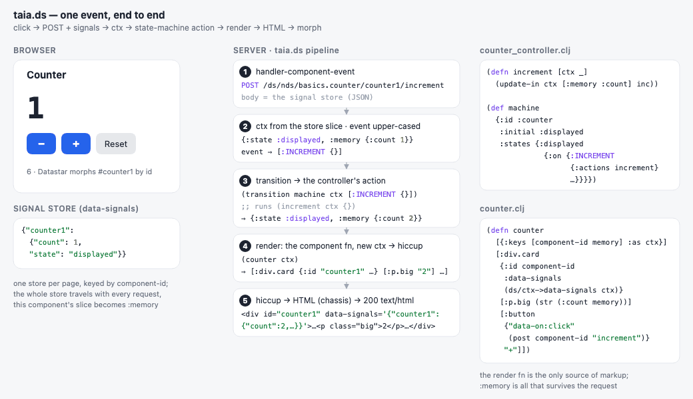
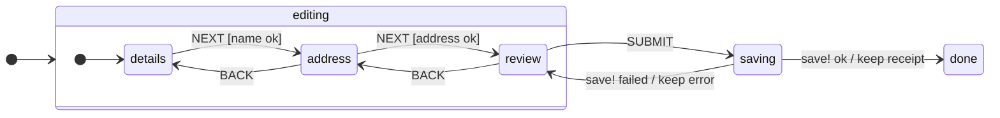

# taia.ds

```clojure
io.github.danbunea/taia.ds {:mvn/version "0.2.0"}
```

Server-side UI components over [Datastar](https://data-star.dev/) SSE, LiveView-style, for Clojure/Ring.
A component is a pure render function `(fn [ctx] -> hiccup)` plus an XState-style hierarchical state machine; the
browser round-trips the component's signals (`:memory`, `:state`) as JSON, the server runs the
transition and streams back patches. Long-lived components keep an SSE connection open so the server
can push UI with `send-ui!`.

Extracted from a production Clojure application, where it drives the whole product UI.

One click on the counter example, end to end — the signal store travels with the POST, the
controller's action produces the new ctx, the render fn turns it into hiccup, and Datastar morphs
the HTML back in:



(The source is [`docs/img/counter-flow.svg`](docs/img/counter-flow.svg), an animated SVG; `bb flow-gif`
re-renders the GIF from it.)

## If you know re-frame

The shape is the same, the place is different. A re-frame app dispatches events, event handlers
turn `db` + event into a new `db`, subscriptions feed views that render hiccup, and all of it runs
in the browser. Here the browser only has Datastar: it POSTs the event together with the
component's signals, the server does the rest and sends HTML back.

| re-frame (browser)                  | taia.ds (server)                                    |
|-------------------------------------|-----------------------------------------------------|
| `app-db`                            | the component's signals (`:memory`, `:state`), round-tripped as JSON |
| `dispatch [:increment]`             | `data-on:click="@post('.../counter1/increment')"`  |
| `dispatch [:add-todo {:title "x"}]` | the payload rides the request, as the query string `@post('.../add-todo?title=x')` or the POST body (the signals); the action receives `[:ADD_TODO {:title "x"}]` |
| `reg-event-db` handler              | an action in the component's state machine, `(fn [ctx event] -> ctx)` |
| `reg-event-fx` effects              | `:invoke` for async work; effects list (`:patch`, `:patch-signals`, `:execute-script`) |
| subscription + Reagent view         | the pure render fn `(fn [ctx] -> hiccup)`           |
| React re-render                     | Datastar morphs the returned HTML by element id      |

What you give up: no client-side state besides the signals, one round trip per event. What you
get: no ClojureScript build, no client/server state sync, server data at hand in every handler,
and `send-ui!` to push UI to connected clients.

## If you know XState

The state machine is an [XState](https://stately.ai/docs/xstate)-style statechart written as a
Clojure map: nested `:states`, `:initial`, `:on` transitions with `:cond` guards and `:actions`,
and `:invoke` with `:on-done` / `:on-error`. The differences: an action is a pure
`(fn [ctx event] -> ctx)` (XState's `assign`, nothing else), an invoke runs synchronously inside
the same request, and there are no parallel states, history states or delayed events. Each HTTP
request is one `transition` call: the browser sends the current state and memory, the server
sends back the new ones with the HTML.

This is the wizard example's machine ([`wizard_controller.clj`](bases/examples/src/taia/ds/examples/components/wizard/wizard_controller.clj)). Left out of the picture: a `NEXT` whose guard fails stays put and sets `:error`, and a machine-wide `RESET` returns to `details`.



The table in [docs/state-machines.md](docs/state-machines.md#if-you-know-xstate) maps each XState
key to its Clojure counterpart.

## What is in the jar

| Brick | Namespace | Role |
|-------|-----------|------|
| `datastar` | `taia.ds.datastar.*` | Ring handlers, request pipeline, component discovery, SSE push, observer hook, `datastar.js` + `sse-reconnect.js` resources |
| `state-machines` | `taia.ds.state-machines.*` | Hierarchical state machine (`transition`), malli schemas, mock helpers |
| `logging` | `taia.ds.logging.*` | Thin [mulog](https://github.com/BrunoBonacci/mulog) wrapper (`trace`, `with-context`, `trace-when`); no publisher is started |
| `extensions` | `taia.ds.extensions.*` | `assoc-if` and friends |

Runtime dependency note: `hyperfiddle/rcf` and `tortue/spy` are real (small) runtime dependencies —
the test blocks live inline in the sources and the state machine requires `spy.core`. RCF blocks
are no-ops unless you call `(hyperfiddle.rcf/enable!)`.

## Documentation

- [Getting started](docs/getting-started.md) · [Components](docs/components.md) · [State machines](docs/state-machines.md) · [Connected components and push](docs/connected-components.md)
- [Testing components](docs/testing.md) · [Gotchas](docs/gotchas.md) (read this one) · [Migration](docs/migration.md) · [API index](docs/api.md)
- [Examples](docs/examples/README.md): six components in `bases/examples`, one concept each, each with a walkthrough and an executable spec. `bb dev` serves them and prints the URL (the page is itself a component).

The same articles render on cljdoc once the jar is on Clojars (`doc/cljdoc.edn`).

## Wiring it into an application

The library ships no routes: your base owns them. Mount the two handlers on these three shapes
(reitit shown; any router that sets `:path-params` works):

```clojure
(require '[taia.ds.datastar.interface :as ds])

["/ds"
 ["/nds"
  ["/:component/:component-id/:controller/:event" {:handler ds/handler-component-event}]
  ["/:component/:component-id/:event"             {:handler ds/handler-component-event}]]
 ["/nds-connect"
  ["/:component/:component-id/:event"             {:handler ds/handler-connected-component-connect}]]]
```

The handlers expect, on the request:

| Key | Who sets it | Used for |
|-----|-------------|----------|
| `:path-params` `:component` `:component-id` `:event` (`:controller` optional) | router | which component / FSM event |
| `:body-params` (JSON, e.g. via muuntaja) or `[:params :datastar]` (GET) | your middleware | the signal store round-trip |
| `[:params :logged-user :user/id]` | your auth middleware | keys SSE connections per user |
| `:app-config` (optional) | your middleware | forwarded into the component ctx |

`handler-connected-component-connect` is **async-only** (`[req respond raise]`): run Jetty with
`:async? true` (or an equivalent async adapter).

At startup:

```clojure
(ds/set-component-search-paths! ["my.app.components"])   ; required: the default is empty
(future (ds/warm-component-cache! ["home.home" "chat.chat"]))   ; optional, avoids first-request load cost
(ds/set-observer! my-metrics-fn)                                 ; optional, see docstring
```

Static assets — add `(ring.middleware.resource/wrap-resource handler "datastar")` (plus
`wrap-content-type`, browsers refuse a module script without a MIME type) and load them from your
page head:

```clojure
[:script {:type "module" :src "/js/datastar.js"}]     ; Datastar v1.0.0-RC.8
[:script {:src "/js/sse-reconnect.js" :defer true}]   ; reconnect watchdog for /ds/nds-connect streams
```

Server-initiated pushes to an open connected component:

```clojure
(ds/send-ui! component-id user-id [[:patch [:div#cc1 "hello"]]])
```

Full-page renders at a canonical URL (`GET /` → a page component's `INIT`):

```clojure
(let [{:keys [html]} (ds/process-component-event req "home.home" "home" "INIT" nil)] ...)
```

## Writing a component

Under one of the search-path prefixes, `<dir>.<name>` is resolved from `"<dir>.<name>"`:

```
my/app/components/counter/counter.clj             ; (ns my.app.components.counter.counter)
my/app/components/counter/counter_controller.clj  ; (ns my.app.components.counter.counter-controller)
```

- `counter.clj` defines `(defn counter [ctx] ...)` — the render fn is **named after the last
  namespace segment** and returns hiccup. Use
  `taia.ds.datastar.adapters.handlers.context/ctx->data-signals` for the `data-signals` attribute.
- `counter_controller.clj` defines `machine`, a hierarchical state machine map
  (`:id`, `:initial`, `:states`, `:on`); actions are `(fn [ctx params] -> ctx)`.
- Events arrive as `POST /ds/nds/counter.counter/<id>/<EVENT>`; `:memory` is your persistent state,
  `:state` the FSM state keyword.

The [examples](docs/examples/README.md) go from a counter to TodoMVC; the brick's own
`adapters/components/counter/` holds the minimal fixtures its tests use.

Effect vocabulary a render fn may return instead of plain hiccup: `[[:patch hiccup opts] …]`,
`[:patch-signals map opts]`, `[:execute-script js opts]`; `opts` keys/values may be `:d*/…` keywords
(resolved against `starfederation.datastar.clojure.api`). `send-ui!` additionally accepts
`[:broadcast hiccup opts]` to reach every user connected under a component-id.

## Development

This is a [Polylith](https://polylith.gitbook.io/) workspace.

```shell
bb test          # Kaocha + RCF inline tests (clojure -M:dev:test)
bb e2e-test      # Playwright against the examples app (needs Node >= 18); bb e2e-test <spec> [--headed]
bb check         # poly check
bb info          # poly info
bb dev           # examples app on port 7788, prints the examples URL (nREPL on 7789)
bb api-index     # regenerate docs/api.md from the interface namespaces
bb format        # cljfmt
bb jar           # target/taia.ds-<version>.jar  (version = 0.1.<git commit count>, or :version "x.y.z")
bb install       # into ~/.m2
bb deploy        # to Clojars
```

`clojure -M:poly <cmd>` runs any other poly command. The library artifact is `projects/taia-ds`
(the four bricks, nothing else); `projects/examples` adds the `examples` base and is never
published. `build.clj` inlines the bricks into one jar whose pom lists Maven libraries only.

### Publishing

1. Verify the `io.github.danbunea` group once on Clojars: create a public GitHub repository named
   `clojars-danbunea` (see [Verified Group Names](https://github.com/clojars/clojars-web/wiki/Verified-Group-Names)).
2. Create a Clojars deploy token and export `CLOJARS_USERNAME` and `CLOJARS_PASSWORD` (the token).
3. `bb deploy` (optionally `bb deploy :version '"0.3.0"'`), then tag `v<version>`.

## Migrating from the in-app namespaces

| Before (in-app)       | After |
|-----------------------|-------|
| `ds.interface`, `ds.adapters.*`, `ds.domain.*` | `taia.ds.datastar.interface`, `taia.ds.datastar.adapters.*`, `taia.ds.datastar.domain.*` |
| `state-machines.*` | `taia.ds.state-machines.*` |
| `logging.interface` | `taia.ds.logging.interface` |
| `extensions.interface` | `taia.ds.extensions.interface` |
| search path `"ds.adapters.components"` | gone: the library has no components of its own, so the default is `[]` and the application lists only its own prefixes |

## License

Eclipse Public License 2.0.
