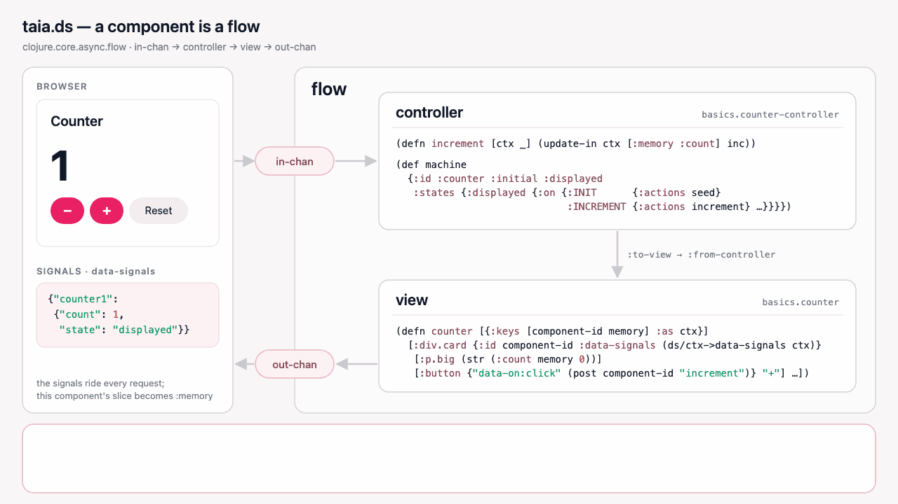
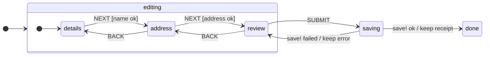

# taia.ds

Datastar + XState-style state machines + Clojure: an opinionated, component-based library for server-side UI.

```clojure
io.github.danbunea/taia.ds {:mvn/version "0.4.0"}
```

Or start a new application from the [`taia/app` template](docs/new-project.md). It sets up a Polylith
workspace with async Jetty, `bb dev` with an nREPL, tests, an uberjar, and the counter and live counter
ready to edit:

```shell
clojure -Tnew create :template io.github.danbunea/taia.ds%template%taia/app :name acme/shop
cd shop && bb dev
```
You may need to do this before, and only once to install deps-new
```shell
clojure -Ttools install-latest :lib io.github.seancorfield/deps-new :as new   # once
```

Server-side UI components over [Datastar](https://data-star.dev/) SSE, LiveView-style, for Clojure/Ring.
A component is a pure render function `(fn [ctx] -> hiccup)` plus an XState-style hierarchical state machine; the
browser round-trips the component's signals (`:memory`, `:state`) as JSON, the server runs the
transition and streams back patches. Long-lived components keep an SSE connection open so the server
can push UI with `send-ui!`, or send the component events with `send-event!`.

Extracted from a production Clojure application, where it drives the whole product UI.

A component is a `core.async.flow` of two procs between an `in-chan` and an `out-chan`: the
**controller** runs the component's state machine, the **view** is its render fn. A click puts the
event, and the component's signals, on the in-chan; the render leaves on the out-chan and Datastar
morphs it into the page:



A connected component's flow stays up as long as its SSE stream, so the
server can send it events too (`send-event!`). This flow receives those server events through the in-chan. On the live counter, a
click POSTs +1 with the tab's signals as a one-shot event: it runs in a flow of its own, built from the same controller and view, and the out-chan passes the result back to the browser; from the REPL,
`(ds/send-event! "live1" "demo-user" "increment" {:count 2})` sends the same event with the memory
as params through the flow the page's connection opened, the same controller code runs, and the
new value goes down the page's open SSE stream, with no click and no request:


(Both are generated: [`scripts/component_flow_svg.clj`](scripts/component_flow_svg.clj) writes the
animated SVGs in [`docs/img/`](docs/img/), and `bb component-flow-gif` renders the GIFs. The click in
more detail, signal store and morph included, is in [example 1](docs/examples/01-counter.md).)

## What you write

Two namespaces per component: 
- a **controller** (the state machine) and 
- a **view** (the render fn).

The whole counter:

```clojure
(ns my.app.components.basics.counter-controller)

(defn seed      [ctx _] (update-in ctx [:memory :count] #(or % 0)))
(defn increment [ctx _] (update-in ctx [:memory :count] inc))
(defn decrement [ctx _] (update-in ctx [:memory :count] dec))
(defn reset     [ctx _] (assoc-in ctx [:memory :count] 0))

(def machine
  {:id      :counter
   :initial :displayed
   :states  {:displayed {:on {:INIT      {:actions seed}
                              :INCREMENT {:actions increment}
                              :DECREMENT {:actions decrement}
                              :RESET     {:actions reset}}}}})
```

```clojure
(ns my.app.components.basics.counter
  (:require [taia.ds.datastar.interface :as ds]))

(defn- post [cid event]
  (str "@post('/ds/nds/basics.counter/" cid "/" event "')"))

(defn counter [{:keys [component-id memory] :as ctx}]
  [:div.card {:id component-id :data-signals (ds/ctx->data-signals ctx)}
   [:h2 "Counter"]
   [:p.big (str (:count memory 0))]
   [:div.row
    [:button {"data-on:click" (post component-id "decrement")} "−"]
    [:button {"data-on:click" (post component-id "increment")} "+"]
    [:button {"data-on:click" (post component-id "reset")} "Reset"]]])
```

Plain functions and data: no handlers, no channels, no SSE, no registration. taia.ds does the rest:

- **Routing.** `POST /ds/nds/basics.counter/counter1/increment` reaches your machine as
  `[:INCREMENT params]`. You mount three handlers once for the whole app, not per component.
- **Discovery.** It finds `counter` and `counter-controller` from the namespace name.
- **Signals.** `:memory` and `:state` round-trip through `data-signals` and come back as the ctx of
  the next event. A key your action removes is deleted in the browser too.
- **The flow.** Your controller and view run as the two procs of a `core.async.flow`, built per
  event. For a connected component it lives as long as its SSE stream. Nothing is kept between
  events: each starts from the tab's signals, or from a server event's params.
- **Connected components.** Streams per user, heartbeats, reconnects, and `send-event!` /
  `send-ui!` for pushes from the server.
- **The response.** Hiccup becomes HTML and Datastar morphs it in by id; an effects list goes out
  as SSE.
- **Observability.** Traces through mulog, plus an observer hook for your metrics.

## If you know re-frame

A re-frame app dispatches events, event handlers
turn `db` + event into a new `db`, subscriptions feed views that render hiccup, and all of it runs
in the browser. Here the browser only has Datastar: it POSTs the event together with the
component's signals, the server does the rest and sends HTML back.

| re-frame (browser)                  | taia.ds (server)                                    |
|-------------------------------------|-----------------------------------------------------|
| `app-db`                            | the component's signals (`:memory`, `:state`), round-tripped as JSON |
| `dispatch [:increment]`             | `data-on:click="@post('.../counter1/increment')"`  |
| `dispatch [:add-todo {:title "x"}]` | the payload rides the request, as the query string `@post('.../add-todo?title=x')` or the POST body (the signals); the action receives `[:ADD_TODO {:title "x"}]` |
| `reg-event-db` handler              | an action in the component's state machine, `(fn [ctx event] -> ctx)` |
| `reg-event-fx` effects              | `:invoke` for async work; effects list (`:patch`, `:patch-signals`, `:execute-script`) |
| subscription + Reagent view         | the pure render fn `(fn [ctx] -> hiccup)`           |
| React re-render                     | Datastar morphs the returned HTML by element id      |

No client-side state besides the signals, one round trip per event. 

## If you know XState

The state machine is an [XState](https://stately.ai/docs/xstate)-style statechart written as a
Clojure map: nested `:states`, `:initial`, `:on` transitions with `:cond` guards and `:actions`,
and `:invoke` with `:on-done` / `:on-error`. The differences: an action is a pure
`(fn [ctx event] -> ctx)` (XState's `assign`, nothing else), an invoke runs synchronously inside
the same request, and there are no parallel states, history states or delayed events. Each HTTP
request is one `transition` call: the browser sends the current state and memory, the server
sends back the new ones with the HTML.

This is the wizard example's machine ([`wizard_controller.clj`](bases/examples/src/taia/ds/examples/components/wizard/wizard_controller.clj)). Left out of the picture: a `NEXT` whose guard fails stays put and sets `:error`, and a machine-wide `RESET` returns to `details`.



The table in [docs/state-machines.md](docs/state-machines.md#if-you-know-xstate) maps each XState
key to its Clojure counterpart.

## Documentation

- [Getting started](docs/getting-started.md) · [Components](docs/components.md) · [State machines](docs/state-machines.md) · [Connected components and push](docs/connected-components.md)
- [Testing components](docs/testing.md) · [Gotchas](docs/gotchas.md) (read this one) · [Migration](docs/migration.md) · [API index](docs/api.md)
- [Examples](docs/examples/README.md): seven components in `bases/examples`, one concept each, each with a walkthrough and an executable spec. `bb dev` serves them and prints the URL (the page is itself a component).

The same articles render on cljdoc once the jar is on Clojars (`doc/cljdoc.edn`).

## Projects using taia.ds

- [TodoMVC-AI-Agent](https://github.com/DanBunea/TodoMVC-AI-Agent): the classic TodoMVC with an AI agent that
  manages the same list through conversation. The page is a `taia.ds` component with its state machine; the
  request pipeline, SSE push and `datastar.js` come from the library.

  [](https://youtu.be/8aHSc9F6aws)

## Writing a component

Under one of the search-path prefixes, `<dir>.<name>` is resolved from `"<dir>.<name>"`:

```
my/app/components/counter/counter.clj             ; (ns my.app.components.counter.counter)
my/app/components/counter/counter_controller.clj  ; (ns my.app.components.counter.counter-controller)
```

- `counter.clj` defines `(defn counter [ctx] ...)` — the render fn is **named after the last
  namespace segment** and returns hiccup. Use `ds/ctx->data-signals` for the `data-signals`
  attribute.
- `counter_controller.clj` defines `machine`, a hierarchical state machine map
  (`:id`, `:initial`, `:states`, `:on`); actions are `(fn [ctx params] -> ctx)`.
- Events arrive as `POST /ds/nds/counter.counter/<id>/<EVENT>`; `:memory` is your persistent state,
  `:state` the FSM state keyword.

The [examples](docs/examples/README.md) go from a counter to TodoMVC.

Effect vocabulary a render fn may return instead of plain hiccup: `[[:patch hiccup opts] …]`,
`[:patch-signals map opts]`, `[:execute-script js opts]`; `opts` keys/values may be `:d*/…` keywords
(resolved against `starfederation.datastar.clojure.api`). `send-ui!` additionally accepts
`[:broadcast hiccup opts]` to reach every user connected under a component-id.

## Development

This is a [Polylith](https://polylith.gitbook.io/) workspace.

```shell
bb test          # Kaocha + RCF inline tests (clojure -M:dev:test)
bb e2e-test      # Playwright against the examples app (needs Node >= 18); bb e2e-test <spec> [--headed]
bb check         # poly check
bb info          # poly info
bb dev           # examples app on port 7788, prints the examples URL (nREPL on 7789)
bb api-index     # regenerate docs/api.md from the interface namespaces
bb template-test # generate a project from template/ and run its bb test, bb check, bb uberjar + a jar smoke test
bb format        # cljfmt
bb jar           # target/taia.ds-<version>.jar  (version = 0.1.<git commit count>, or :version "x.y.z")
bb install       # into ~/.m2
bb deploy        # to Clojars
```

`clojure -M:poly <cmd>` runs any other poly command. The library artifact is `projects/taia-ds`
(the four bricks, nothing else); `projects/examples` adds the `examples` base and is never
published. `build.clj` inlines the bricks into one jar whose pom lists Maven libraries only.

## License

Eclipse Public License 2.0.
