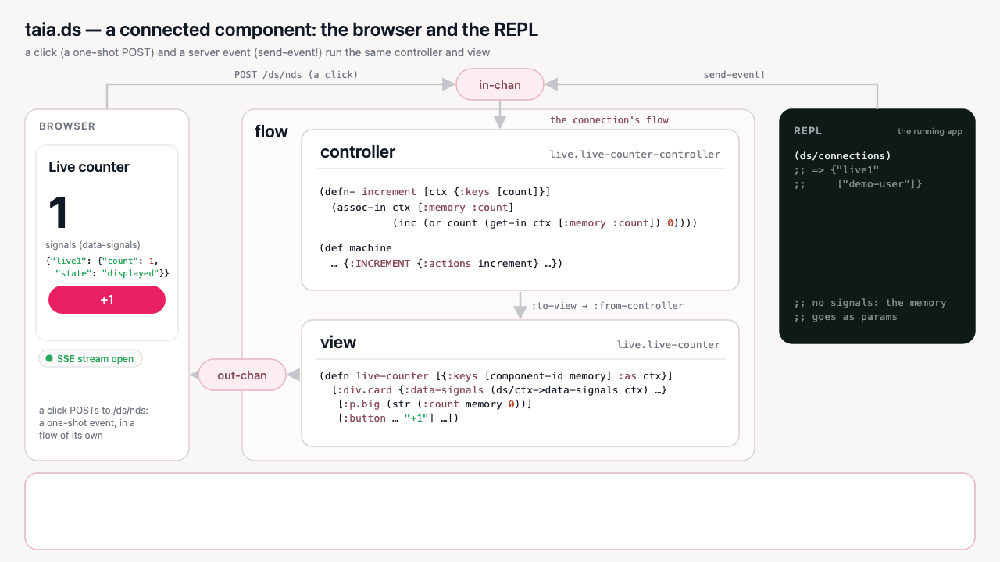

# Connected components and push

A one-shot component answers a request and is done. A **connected** component opens an SSE stream
the server can write to for as long as the page lives.

## Opening the stream

```clojure
[:div {:id "live1" "data-init" "@get('/ds/nds-connect/live.live-counter/live1/init')"} "…"]
```

`handler-connected-component-connect` starts the component's **flow** (below), registers it and
the stream under `[component-id user-id]` (the user from `[:params :logged-user :user/id]`), runs
the INIT through the flow and sends the render down the stream as a patch. The stream then stays
open; the server heartbeats every **15 s**. A second stream for the same `[component-id user-id]`
replaces the first, and stops the first one's flow.

The handler is async only — `[req respond raise]`.

## The component flow

Every event — one-shot or connected — runs through a `clojure.core.async.flow` of two procs:

```
in-chan ──▶ :controller ──:to-view──▶ :view ──▶ out-chan
            (state machine)            (render)
```

The machine and the render fn are resolved once, when the flow is built. A one-shot event
(`/ds/nds/…`) gets a flow of its own, which is stopped as soon as it answers. A connected
component's flow lives as long as its stream, so later events go in through the same in-chan.

**Nothing is kept between events**, one-shot or connected. A browser event starts from the
tab's signals (its `:state` and `:memory`), exactly as in a one-shot component. A server event
has no request and no signals: it starts from the machine's initial state, and brings what it
needs as its params. Whatever an action adds to the ctx for a render (a result list, say) is
rendered, sent, and gone; nothing grows on the server per connection.

Two kinds of event reach that flow after the INIT.

**A browser event**: `@post` to the connect path itself. Mount the `:post` route next to the
`:get` one:

```clojure
["/nds-connect"
 ["/:component/:component-id/:event"
  {:get  {:handler ds/handler-connected-component-connect}
   :post {:handler ds/handler-connected-component-event}}]]
```

```clojure
[:button {"data-on:click" "@post('/ds/nds-connect/live.countdown/countdown1/start')"} "Start"]
```

The event runs through the user's flow, and the POST is answered with the render, exactly like a
one-shot component (HTML, or a one-shot SSE for an effects list); it is not pushed down the
stream as well. With no open stream (closed, or reconnecting) the POST falls back to the one-shot
handler, so the click still renders.

**A server event**: `send-event!`.

```clojure
(ds/send-event! "countdown1" "alice" "tick" {:remaining 4})   ; => true, or false with no open stream
```



It runs from the machine's initial state with its params, and its render is pushed down that
user's stream, on the same ordered write queue as `send-ui!`. The sender's mulog context travels
with it. This is the counterpart of `send-ui!` that keeps the component's own render fn as the
single source of markup: send the *event*, not the patch.

### What a server event starts from

Since a server event starts from the machine's initial state, handle it where that state can see
it (on the machine's own `:on`, for an event that can arrive in any state) and send what its
action needs as params. The countdown's ticker sends `{:remaining 4}`, `{:remaining 3}`, … and
its TICK, handled at the machine level, sets `:remaining` from them. State that must be shared
or outlive a tab (the live counter's count) lives in your own storage, and actions read it.

## Pushing

```clojure
(ds/send-ui! component-id user-id
             [[:patch [:div#live1 …] {:d*/selector "#live1"}]])              ; this user's stream

(ds/send-ui! component-id user-id
             [[:broadcast [:div#live1 …] {:d*/selector "#live1"}]])          ; every user under component-id
```

`send-ui!` is fire-and-forget: it queues on a channel, a consumer writes to each stream on that
user's own write queue, and a failed write evicts the connection. The calling user must have an
open stream (`:broadcast` is resolved from the registry, so it reaches everyone else too). The
caller's mulog context travels with the message, so pushes trace under the originating work.

Where pushes come from in practice: a background job, an LLM agent's output handler, another
user's request. The [live counter](examples/02-live-counter.md) pushes from a transition action to
keep the example in one file; do not read that as a recommendation.

## Mixing one-shot and connected

Clicks on a connected component may also be ordinary `@post` events to `/ds/nds/…`: they run in a
flow of their own, from the client's signals, exactly like a POST to `/ds/nds-connect/…` (which
goes through the stream's flow instead). Either way the response patches the clicking tab, and a
push patches everybody. Datastar morphs by id, so a tab receiving both ends up with the same DOM.

## The reconnect watchdog

Datastar RC8 does not reopen a stream that closes cleanly, retries an errored one ten times then
gives up, and Safari can kill a stream silently. `sse-reconnect.js` (shipped in the jar) watches
every `@get` to `/ds/nds-connect/` and, when it finishes, fails for good, is restored from BFCache
or sees 40 s of silence while the tab is visible, dispatches `ds-reconnect` on the element that
opened it. Opt in per element:

```clojure
[:div {:id "live1"
       "data-init"            "@get('/ds/nds-connect/live.live-counter/live1/init')"
       "data-on:ds-reconnect" "@get('/ds/nds-connect/live.live-counter/live1/init')"}]
```

A reconnect re-sends INIT **in whatever state the component is**, so every displayable state
must handle `:INIT` (an empty map is enough).

## Observing

```clojure
(ds/set-observer! (fn [m] …))   ; nil removes it
```

Both handlers report plain maps with bounded labels and no component-id:
`{:type :event :route :nds|:nds-connect|:nds-connect-event :component … :event … :outcome … :seconds …}`
(`:nds-connect` is a stream's initial render, `:nds-connect-event` a POST through its flow),
`{:type :sse-opened :component …}`, `{:type :sse-closed :component … :seconds …}`. Observer
errors are swallowed; it must never fail a request. Plug Prometheus, mulog or a println in here.
