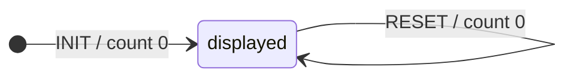
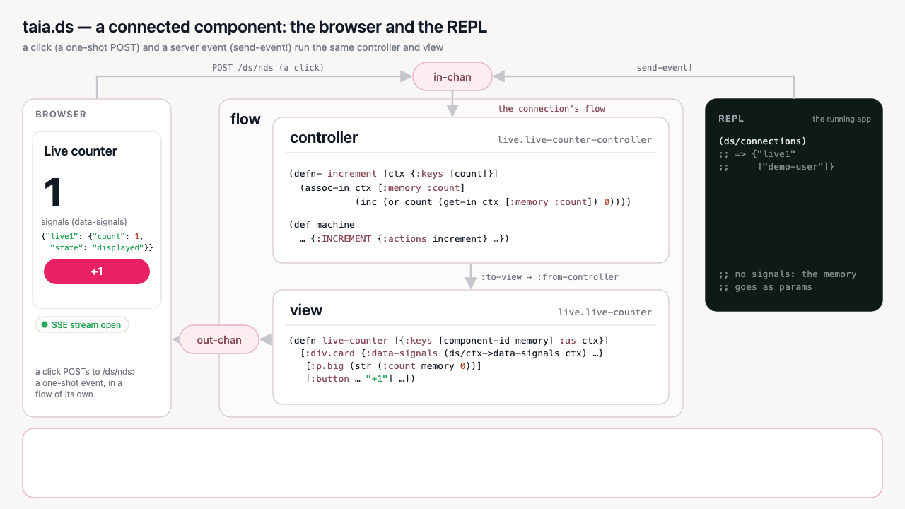

# 2 · Live counter

`live.live-counter` — [`live_counter.clj`](../../bases/examples/src/taia/ds/examples/components/live/live_counter.clj),
[`live_counter_controller.clj`](../../bases/examples/src/taia/ds/examples/components/live/live_counter_controller.clj).

A connected component with two ways in. The home page mounts it with
`@get('/ds/nds-connect/…/init')`, so the INIT render arrives on an SSE stream that stays open, with
the component's flow behind it. A click and a server event both go in through that flow's in-chan.

**State machine**



**What to look at**

- The count is the **tab's**: it lives in `:memory` and round-trips through `data-signals`, like
  the [counter](01-counter.md)'s. Nothing is kept on the server.
- A click is a `@post` to the **nds-connect** path, so it runs through the flow the tab's stream
  opened. It carries the tab's signals, so `increment` starts from the count in `:memory`, and
  the POST is answered with the render.
- A **server event** — `send-event!`, here from the REPL — has no request and no signals,
  so it brings the count as its params: `{:count 2}`. `increment` starts from the params' count
  when there is one. Its render is pushed down the open stream, and the render's `data-signals`
  update the tab's store, so the next click carries the new count.
- The buttons append `?user='+$user` from a page-level signal, because the examples app identifies
  users by that query param — stand-in for real authentication, which would set
  `[:params :logged-user]` from a session.

A click and a `send-event!` from the REPL, step by step, through the same in-chan:



**Try it**: open `?example=live-counter`, click +1 a few times, then from a REPL on port 7789
(without `&user=…` the examples app signs you in as `demo-user`):

```clojure
(require '[taia.ds.datastar.interface :as ds])
(ds/send-event! "live1" "demo-user" "increment" {:count 41})   ; the tab shows 42 — the next click makes it 43
(ds/send-event! "live1" "demo-user" "reset" {})                ; back to 0
```

The controller's comment block has the same calls, next to the code they drive.

**Spec**: block 2 in `examples_test.clj` (a click starts from the signals, a server event from its
params; the render carries the count in `data-signals`), and `e2e/tests/live-counter.spec.ts`.
