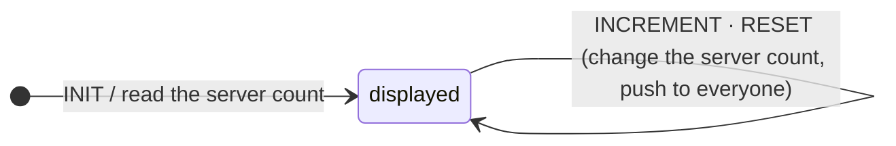

# 2 · Live counter

`live.live-counter` — [`live_counter.clj`](../../bases/examples/src/taia/ds/examples/components/live/live_counter.clj),
[`live_counter_controller.clj`](../../bases/examples/src/taia/ds/examples/components/live/live_counter_controller.clj).

A connected component. The home page mounts it with `@get('/ds/nds-connect/…/init')`, so the INIT
render arrives on an SSE stream that stays open.

**State machine**



**What to look at**

- No `data-signals` on the root: the count is an atom on the server, put into top-level ctx by the
  INIT action. Nothing is the client's to round-trip.
- `INCREMENT` is an ordinary one-shot `@post`. Its action bumps the atom and calls
  `ds/send-ui!` with a `:broadcast` effect, which reaches every stream registered under the
  component-id. The clicking tab also gets the one-shot response; both patch the same id.
- The buttons append `?user='+$user` from a page-level signal, because the examples app identifies
  users by that query param — stand-in for real authentication, which would set
  `[:params :logged-user]` from a session.

**Try it**: open the live-counter page as `?example=live-counter&user=alice` and `…&user=bob` side by
side; click in one, watch the other. From a REPL on port 7789:

```clojure
(taia.ds.datastar.interface/send-ui! "live1" "alice"
  [[:broadcast [:div#live1 [:h2 "pushed"]] {:d*/selector "#live1"}]])
```

**Caveat**: pushing from a transition action keeps the example in one file; in an application the
push comes from the thing that knows something changed (a job, an agent, a use case).

**Spec**: block 2 in `examples_test.clj` (the count is in ctx, not `:memory`; a different user sees
the same number).
