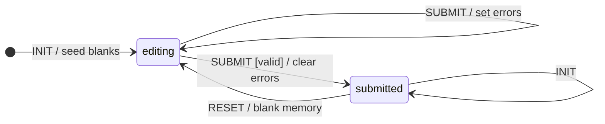

# 3 · Signup form

`signup.signup` — [`signup.clj`](../../bases/examples/src/taia/ds/examples/components/signup/signup.clj),
[`signup_controller.clj`](../../bases/examples/src/taia/ds/examples/components/signup/signup_controller.clj).

**State machine**

**What to look at**

- Inputs carry `"data-bind" "signup1.name"`: typing writes the field into this component's slice
  of the store; no request per keystroke. The next event finds `(:name memory)` filled in.
- `SUBMIT` is a vector of options. The first has `:cond valid?` and a target; the second has no
  `:cond` and no target, so it stays in `:editing` and records `:errors`.
- When there are errors the render fn returns an **effects list**: `[:patch (form ctx) {}]` plus
  `[:execute-script "…focus()"]`. Any render may return hiccup or effects.
- `:submitted` handles `:INIT {}` — the re-INIT hatch every displayable state needs.
- A valid submit `dissoc`s `:errors`; the pipeline sends it back as `null` so the client deletes the
  signal (the spec asserts `:errors nil`, not its absence).

**Spec**: block 3 in `examples_test.clj`.
