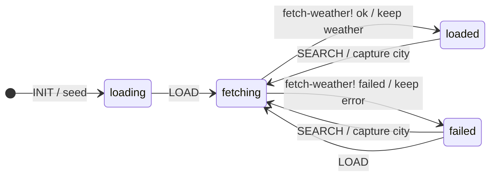

# 6 · Weather

`weather.weather` — [`weather.clj`](../../bases/examples/src/taia/ds/examples/components/weather/weather.clj),
[`weather_controller.clj`](../../bases/examples/src/taia/ds/examples/components/weather/weather_controller.clj),
[`weather_api.clj`](../../bases/examples/src/taia/ds/examples/components/weather/weather_api.clj).

An `:invoke` that calls a public API ([Open-Meteo](https://open-meteo.com/), no key), and the two
loading patterns you will use everywhere.

**State machine**

**The lazy load.** Invokes run synchronously inside the request, so a fetch in INIT would hold the
first paint. Instead INIT renders a skeleton (`:loading`) whose `data-init` posts `LOAD` at once;
LOAD enters `:fetching`, whose invoke does the slow work, and the response replaces the skeleton
with `:loaded` or `:failed`. Two requests, instant first paint. Any component that loads something
expensive on open should look like this.

**The in-flight indicator.** The search buttons carry `data-indicator="_weatherBusy"`: Datastar
sets `$_weatherBusy` true while their request is pending, so `data-show` on the spinner and
`data-attr:disabled` on the buttons work without the server knowing. The leading underscore makes
the signal Datastar-local; it never rides along to the server.

**Where the data lives.** The city — the user's choice — is in `:memory` (bound to the input). The
weather and the error are in **top-level ctx**: derived data, re-fetched on demand, never echoed
back from the client. The retry in `:failed` is a plain `LOAD` and `INIT` is machine-wide, so a
reconnect re-fetches from any state.

**Capture before invoke.** The quick picks post `search?city=Oslo`; the invoke cannot see event
params, so `capture-city` stores it in `:memory` in the transition's `:actions` and
`fetch-weather!` reads it from there.

**Errors as data.** `weather-api` throws `ex-info` with a user-facing `:message` for an unknown
place or a failing service; `:on-error` puts it in ctx and the render shows it.

**Try it**: `bb dev`, open the weather page (`?example=weather` on the URL it prints), type a city, try a nonsense one. The e2e run sets
`TAIA_EXAMPLES_FAKE_WEATHER=1`, which answers four cities from a table after 700 ms instead of
calling the network.

**Spec**: block 6 in `examples_test.clj` (the API is redefined with a spy: INIT does not fetch, LOAD
fetches once with the city, SEARCH captures the param first, the error path) and
`e2e/tests/weather.spec.ts` (skeleton first, indicator during a search, recovery from `:failed`).
