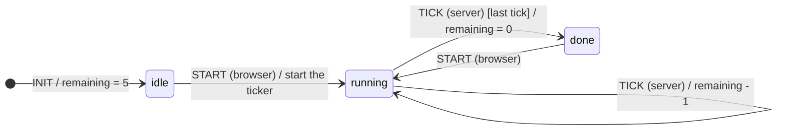

# 7 · Countdown

`live.countdown` — [`countdown.clj`](../../bases/examples/src/taia/ds/examples/components/live/countdown.clj),
[`countdown_controller.clj`](../../bases/examples/src/taia/ds/examples/components/live/countdown_controller.clj).

A connected component whose state lives in its **flow** (see
[Connected components](../connected-components.md#the-component-flow)). The home page mounts it with
`@get('/ds/nds-connect/…/init')`, which opens the stream and starts the component's flow. That
flow's controller holds the ctx until the stream closes.

**State machine**



**What to look at**

- No `data-signals` and no atom: `:remaining` is top-level ctx, held by the flow between events.
- START is a `@post` to the **nds-connect** path, not `/ds/nds/`. It runs through the tab's flow
  and the POST is answered with the `:running` render directly.
- The START action starts a ticker that calls `ds/send-event! cid user "tick" {}` once a second.
  TICK's action is the named fn `tick`: `(update ctx :remaining dec)`.
  Each TICK is a server event with no request: it transitions from the held ctx, and the render fn
  turns it into a patch pushed down the stream. The controller never builds a patch by hand,
  unlike the [live counter](02-live-counter.md)'s `send-ui!`.
- `send-event!` returns false once the tab's stream has closed, and that stops the ticker.
- Each tab (each `?user=`) has its own stream, so its own flow and its own countdown.

**Try it**: open `?example=countdown` and press Start. To drive it from a REPL while the page
is open (without `&user=…` the examples app signs you in as `demo-user`, as the page footer says):

```clojure
(taia.ds.datastar.interface/connections)                                       ; => {"countdown1" ["demo-user"]}
(taia.ds.datastar.interface/send-event! "countdown1" "demo-user" "start" {})   ; START from the server
```

`send-event!` answers `false` when that user has no open stream under that component-id;
`connections` shows who does. The [live counter](02-live-counter.md) shows a click and a REPL
event going through the same in-chan, step by step.

**Caveat**: the held ctx is in memory and dies with the stream. A reload starts again from INIT.

**Spec**: block 7 in `examples_test.clj` (a connected flow driven headless with `ts/connect`,
`ts/flow-event` and `ts/server-event`) and `e2e/tests/countdown.spec.ts`.
