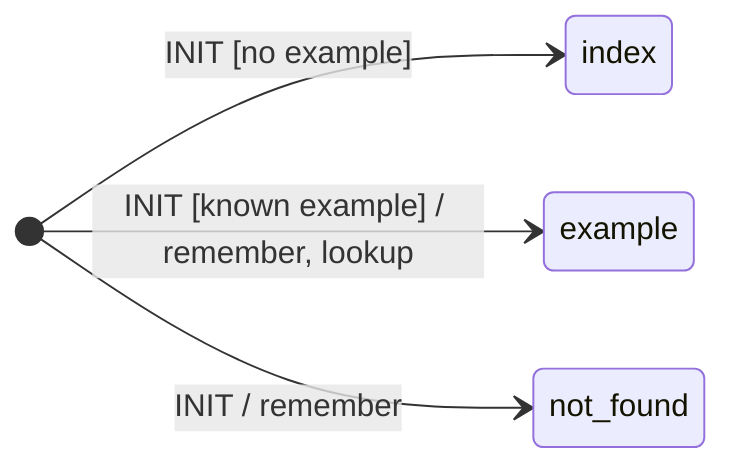

# Examples

Six components, one concept each, in `bases/examples/src/taia/ds/examples/components/`. Run them:

```shell
bb dev          # prints the examples URL
```

There is no route for the examples page: the page is itself a component, `home.home`, and a GET
on its own INIT route — `/ds/nds/home.home/home/init?example=counter` — renders it. `start!`
returns that URL. It keeps the user and the example's name in `:memory`, resolves the registry
entry into ctx, and
mounts the example's component in a `div` whose `data-init` fires the child's INIT:



Every example page ends with a live view of the component's `:state` and `:memory` — exactly what
round-trips through the signal store, refreshed on every event. Every example has an article here
and an executable spec in
[`examples_test.clj`](../../bases/examples/test/taia/ds/examples/examples_test.clj).

| | Shows | Component |
|-|-------|-----------|
| [1 · Counter](01-counter.md) | one-shot events, `:memory` round-trip, the render fn as the single source of markup | `basics.counter` |
| [2 · Live counter](02-live-counter.md) | a connected component: SSE stream, server-owned state, `send-ui!` + `:broadcast` | `live.live-counter` |
| [3 · Signup form](03-signup-form.md) | `data-bind` form signals, guarded transitions, an effects list with `:execute-script` | `signup.signup` |
| [4 · Wizard](04-wizard.md) | hierarchical states, relative targets, machine-wide RESET, `:invoke` with on-done / on-error | `wizard.wizard` |
| [5 · TodoMVC](05-todomvc.md) | query-string params, filters, inline editing, keyboard expressions | `todomvc.todomvc` |
| [6 · Weather](06-weather.md) | an invoke calling a public API, lazy-load skeleton, `data-indicator`, the error path | `weather.weather` |

The application around them — the `/ds` routes, middleware, the server — is
[`core.clj`](../../bases/examples/src/taia/ds/examples/core.clj); the page that mounts them is the
[`home`](../../bases/examples/src/taia/ds/examples/components/home/home.clj) component and the
registry sits in its [controller](../../bases/examples/src/taia/ds/examples/components/home/home_controller.clj).
It is the reference for your own base.
