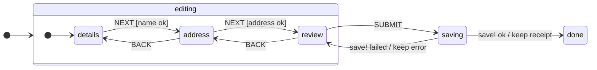

# State machines

`taia.ds.state-machines` is a small hierarchical state machine: a data literal interpreted by one
function, `transition`. The Datastar pipeline calls it as

```clojure
(transition machine ctx [:EVENT event-params] {:state-key :state})
```

and renders whatever comes back.

## Shape

```clojure
(def machine
  {:id      :wizard
   :initial [:editing :details]                 ; keyword, or vector for a nested start
   :on      {:RESET {:target [:editing :details] :actions reset}}   ; machine-wide events
   :states  {:editing {:states {:details {:on {:NEXT [{:target :address :cond name-ok? :actions clear-error}
                                                      {:actions (set-error "Name is required")}]}}
                                :address {:on {:BACK :details :NEXT :review}}
                                :review  {:on {:SUBMIT {:target [:saving]}}}}}
             :saving  {:invoke {:id :save :src save!
                                :on-done  {:target [:done] :actions keep-receipt}
                                :on-error {:target [:editing :review] :actions keep-error}}}
             :done    {}}})
```

## Transitions

A value under `:on {:EVENT …}` is one of:

| Form | Meaning |
|------|---------|
| `:target-state` | go there |
| `{:target :x :actions f}` | go there after running `f` |
| `{:actions f}` | stay in the current state, run `f` |
| `{}` | stay, do nothing — the idiom for "this event is fine here" |
| `[{:cond c1 …} {:cond c2 …} {…}]` | the first option whose `:cond` passes (or has none) |

- `:actions` is `(fn [ctx event-params] -> ctx)`. It is the **only** place state changes; return
  the whole ctx.
- `:cond` is `(fn [ctx event-params] -> boolean)` and sees `:memory`, so validation is a guard.
- Lookup order: the machine's `:on` first, then the current state's `:on` (for nested states, the
  leaf's). An event handled nowhere is **dropped with a warning**, not thrown — see
  [Gotchas](gotchas.md#an-unhandled-event-is-dropped-not-thrown).

## Nested states

State is a path: `[:editing :address]`. Inside a nested state, `:target :review` is **relative**
(it replaces the last segment). To leave the parent give the full path: `:target [:saving]`, and a
single-element vector collapses to the keyword `:saving`. In the signal store the state is the
JSON array `["editing","address"]`; the pipeline coerces it back to keywords.

## Invokes

A state with `:invoke` runs its `:src` **synchronously, inside the same transition**, as soon as
the state is entered:

- `:src` is `(fn [ctx] -> result)`. It gets the ctx only — **not the event params**. Capture any
  param you need in the transition's `:actions` first, then read it from ctx.
- Return value → `:on-done`, whose `:actions` is `(fn [ctx result] -> ctx)`; the result is not
  merged automatically.
- `(throw (ex-info msg data))` → `:on-error`, whose `:actions` is `(fn [ctx ex-data] -> ctx)`.
- `:on-done` / `:on-error` accept the same forms as transitions, including conditional vectors
  (`:cond` there is `(fn [ctx result])`). If the target state has an invoke too, it runs next.

Because the invoke is synchronous, the render fn never sees the invoking state unless an error
path lands there: a one-shot request goes `review → saving → done` in one call.

## Testing a machine

`taia.ds.state-machines.interface` exposes `transition` and `make-machine-testable`; the
`test-helpers` namespace adds a declarative runner, `test-machine`, which asserts the target and the
ordered trace of action/invoke names per `[from-state event]` without running invokes. The
[examples suite](testing.md) prefers driving machines through the pipeline, which also covers the
render.

## If you know XState

The machine is an [XState](https://stately.ai/docs/xstate)-style statechart as a Clojure map.

| XState | taia.ds |
|--------|---------|
| `states`, nested `states` | `:states`, nested `:states` |
| `initial: 'a'` | `:initial :a`, or `[:a :b]` to start inside a nested state |
| `on: { EVENT: 'target' }` | `:on {:EVENT :target}`; targets are relative to the parent, a vector leaves it |
| `on: { EVENT: { target, guard, actions } }` | `{:target … :cond … :actions …}`; several options as a vector, the first passing `:cond` wins |
| root-level `on` | machine-wide `:on` |
| `actions` / `assign` | `:actions`, a pure `(fn [ctx event] -> ctx)` returning the new ctx |
| `invoke: { src, onDone, onError }` | `:invoke {:src f :on-done {…} :on-error {…}}`; `src` is `(fn [ctx] -> result)` and runs synchronously inside the transition |
| `machine.transition(state, event)` | `(transition machine ctx [:EVENT params] {:state-key :state})` |
| `type: 'parallel'`, history states, `after`, `entry` / `exit`, actors | not supported |

The wizard machine from the examples, as a state diagram (a `NEXT` whose guard fails stays put and sets `:error`; the machine-wide `RESET` returns to `details`):


